# PRISMA Architecture Specification

This document defines the software architecture, data contracts, and pipeline execution for simulating microscale particle motion inside a Random Positioning Machine (RPM).

---

## 1. Structural Overview

The package enforces a strict one-way dependency model organized around 3 modules: 

```text
src/core/ (conventions, kinematics, physical models)
    ▲
    │
src/trajectory/ (motor angle profiles, CSV parsing, KinematicProfile generation)
    ▲
    │
src/solver/ (RK4 integration, physical regimes, boundary enforcement)
    ▲
    │
src/cli.py (command-line entrypoint, preset configuration, execution pipeline)
```

- `core` provides foundational invariants (frames, kinematic transformations, physics abstractions). It has zero internal dependencies.
- `trajectory` consumes kinematic mappings from `core` to convert experimental or synthetic motor profiles into vectorized kinematic representations.
- `solver` couples a `PhysicalSystem` with a `KinematicProfile` to numerically integrate the trajectory and generate output data containers.
- `cli` coordinates CLI argument parsing, manages physical presets, and orchestrates execution without embedding numerical mathematics.

---

## 2. Directory tree 

Below is the physical layout of the `src/` directory. Each subpackage adheres to single-responsibility principles, hosting distinct domains of the simulation pipeline:

```text 
src
├── __init__.py
├── cli.py                  # Argument parsing (argparse) and simulation 
├── core
│   ├── __init__.py
│   ├── conventions.py      # Reference frames (R0, R1, R2), gravity 
│   ├── kinematics.py       # Canonical 2-axis kinematics engine, rotation 
│   ├── models.py
│   └── physics.py          # Particle, Fluid, PhysicalSystem, KinematicProfile, SimulationResult
├── solver
│   ├── __init__.py
│   └── solver.py           # Solver base class and RK4Overdamped implementation
├── stats
│   ├── metrics.py          # Metrics helpers on Trajectory and SimulationResult containers for analytics
│   ├── plotting.py         # Matplotlib generator helpers for PDF export
│   ├── report.py           # Report contract and TrajectoryReport implementation
│   └── simulation_report.py    # SimulationReport implementation
├── trajectory
│   └── Trajectory.py        # CSV import/export, profile generation, kinematic 
│   └── generators.py        # Trajectories definitions and generators
└── utils.py                 # File header extraction and metadata parsers

```
An extensive test harness mirrored under `tests/` ensures bidirectional validation between kinematics and physics, enforcing contract consistency across all modules.

---

## 3. Data Contracts

Inter-module communication relies on lightweight, immutable data containers (Python dataclasses). This approach standardizes memory layouts, prevents unintended side effects during time-stepping loops, and simplifies unit-testing by clearly delineating expected inputs from computed results.

### 3.1 KinematicProfile (src/core/physics.py)

This structure encapsulates the complete time-history of the machine's state. It provides pre-computed spatial and rotational vectors projected into the moving frame $\mathcal{R}_2$, offloading coordinate transformations from the solver's inner integration loop.

Standard immutable container passed to numerical solvers:
- `timestamp` : `np.ndarray` — Continuous time vector $t \in \mathbb{R}^N$ (in seconds).
- `theta1`, `theta2`: `np.ndarray` — Inner axis (azimuth) and outer axis (tilt) motor positions ($N$, in radians).
- `omega1`, `omega2`: `np.ndarray` — Angular velocities $\dot{\theta}_1, \dot{\theta}_2$ ($N$, in $\text{rad/s}$).
- `g` : `np.ndarray` — Vectorized apparent gravity trajectory in sample frame $\mathcal{R}_2$ ($(N, 3)$, in $\text{m/s}^2$).
- `Omega` : `np.ndarray` — Angular velocity vector $\vec{\Omega}_{\mathcal{R}_2}$ ($(3, N)$, in $\text{rad/s}$).
- `Omega_dot` : `np.ndarray` — Angular acceleration vector $\dot{\vec{\Omega}}_{\mathcal{R}_2}$ ($(3, N)$, in $\text{rad/s}^2$).

### 3.2 SimulationResult (src/core/physics.py)

Produced upon completion of the numerical integration, this container packages the full dynamical history of the particle along with dimensionless validation metrics, providing a single payload for downstream analysis and 3D visualization.

Container holding resolved trajectory dynamics:
- `timestamp` : `np.ndarray` — Time base ($(N,)$).
- `positions` : `np.ndarray` — Cartesian coordinates $\vec{r}(t)$ in sample frame $\mathcal{R}_2$ ($(N, 3)$, in meters).
- `velocities` : `np.ndarray` — Particle velocity vectors $\vec{v}(t)$ ($(N, 3)$, in $\text{m/s}$).
- `reynolds` : `np.ndarray` — Particle Reynolds number history $Re_p(t)$ ($(N,)$).

---

## 4. Pipeline Execution Flow 

The standard execution pipeline transforms raw experimental or synthetic angular profiles into high-fidelity trajectories through four sequential stages:
1. **Parameter & Preset Ingestion**: The CLI parses inputs, assigns physical presets, and configures overrides for the particle anchor x0 and fluid stiffness k.
2. **Ingestion & Kinematics Parsing**: Trajectory coordinates are parsed, validated, and converted into continuous kinematic profiles via the canonical two-axis mapping engine.
3. **Dynamical Solving**: The numerical solver evaluates instantaneous limit velocities—including hydrodynamic drag, centrifugal/Euler fictitious forces, and cytoskeletal restoring forces—advancing coordinates via an explicit 4th-order Runge-Kutta scheme.
4. **PDF export**: Exporting `SimulationResult` into PDF file using `SimulationReport` generator. 

### 4.1 Dynnamic Simulation Workflow

```text
CLI Arguments / Presets (glycerol_bead, statolith)
         │
         ▼
CSV Trajectory File [timestamp, theta1, theta2]
         │
         ▼ (Trajectory.from_csv)
Trajectory.compute_kinematics()
         │
         ▼
   KinematicProfile
         │
         ├───► RK4Overdamped.solve(kin, v0)
         │         ├── Local evaluation of v_limit(r, g, w, dw)
         │         │     └── Hydrodynamic + Centrifugal + Euler - (r - x0)/tau_k
         │         ├── 4th-order Runge-Kutta step
         │         └── Instantaneous Re_p computation
         ▼
   SimulationResult
         │
         ▼
    ┌─── └─────────┐
    │              │
    ▼              │
CSV Export         │
                   │
                   ▼
              PDF Export
```

---

## 5. Class diagram 

The following class diagram illustrates the object-oriented structure of the framework, highlighting the relationship between the kinematics backend, the physical system configuration, and the polymorphic solver hierarchy:

```mermaid 
classDiagram
    %% ==========================================
    %% Core Kinematics
    %% ==========================================
    class CanonicalTwoAxis {
        +int n_axes
        +angles_to_point(angles) ndarray
        +point_to_angles(point) ndarray
        +rotation(angles) Rotation
    }

    %% ==========================================
    %% Trajectory Module & Generators
    %% ==========================================
    class Trajectory {
        +float step_s
        +float duration_s
        +str description
        +str generation_date
        +CanonicalTwoAxis kin
        +ndarray timestamp
        +ndarray theta1
        +ndarray theta2
        +Logger LOG
        +from_csv(filepath: str)
        +to_csv(filepath: str)
        +compute_kinematics() KinematicProfile
        +get_gravity_positions() ndarray
        +get_omegas() tuple
        +process_angular_velocity(omega1, omega2) ndarray
        +generate(duration_s, step_s, profile, **params)
        +display()
    }

    class GeneratorsModule {
        <<module>>
        +dict PROFILES
        +generate_random_walk(duration_s, dt) tuple
        +generate_desynchronized_sine(duration_s, step_s) tuple
        +generate_constant_speed_ratio(duration_s, step_s, omega) tuple
        +generate_static_1g(duration_s, step_s) tuple
        +generate_clinostat_1d(duration_s, step_s) tuple
        +generate_centrifuge_sweep(duration_s, step_s) tuple
    }

    Trajectory *-- CanonicalTwoAxis : uses
    Trajectory ..> GeneratorsModule : calls
    Trajectory --> KinematicProfile : produces

    %% ==========================================
    %% Data Containers
    %% ==========================================
    class KinematicProfile {
        +ndarray timestamp
        +ndarray theta1
        +ndarray theta2
        +ndarray g
        +ndarray omega1
        +ndarray omega2
        +ndarray Omega
        +ndarray Omega_dot
    }

    class SimulationResult {
        +ndarray timestamp
        +ndarray positions
        +ndarray velocities
        +ndarray reynolds
    }

    %% ==========================================
    %% Core Physics
    %% ==========================================
    class Particle {
        <<frozen>>
        +float radius
        +float rho
        +ndarray x0
        +volume() float
        +mass() float
    }

    class Fluid {
        <<frozen>>
        +float rho
        +float mu
        +float k
    }

    class PhysicalSystem {
        +Particle particle
        +Fluid fluid
        +float beta
        +float gamma
        +float tau_v
        +compute_reynolds(v_norm) ndarray
        +compute_tau_k() float | bool
        +display()
    }

    PhysicalSystem *-- Particle
    PhysicalSystem *-- Fluid

    %% ==========================================
    %% Solvers
    %% ==========================================
    class Solver {
        <<abstract>>
        +PhysicalSystem system
        +float r_tube
        +bool overdamped
        +Logger LOG
        +solve(kin: KinematicProfile, v0: ndarray)* SimulationResult
    }

    class RK4Overdamped {
        +solve(kin: KinematicProfile, v0: np.ndarray) SimulationResult
        +v_limit(r, g, Omega, Omega_dot) ndarray
    }

    Solver <|-- RK4Overdamped : inherits
    Solver o-- PhysicalSystem : references
    Solver ..> KinematicProfile : consumes
    Solver ..> SimulationResult : returns

    %% ==========================================
    %% Reporting & Statistics System
    %% ==========================================
    class Report {
        <<abstract>>
        +Path output_path
        +compute_metrics()* dict
        +generate_plots()* dict
        +assemble_pdf(output_path)* Path
        +show_CLI()* void
    }

    class TrajectoryReport {
        +Trajectory traj
        +dict metrics
        +dict figures
        +from_csv(filepath, output_path, log)$ TrajectoryReport
        +compute_metrics() dict
        +generate_plots() dict
        +assemble_pdf(output_path) Path
        +show_CLI() void
    }

    class SimulationReport {
        +SimulationResult result
        +KinematicProfile kin
        +PhysicalSystem system
        +float r_tube
        +dict metrics
        +dict figures
        +from_csv(filepath, r_tube, output_path)$ SimulationReport
        +compute_metrics() dict
        +generate_plots() dict
        +assemble_pdf() Path
        +show_CLI() void
    }

    Report <|-- TrajectoryReport : inherits
    Report <|-- SimulationReport : inherits

    TrajectoryReport o-- Trajectory : analyzes
    SimulationReport o-- SimulationResult : analyzes
    SimulationReport o-- KinematicProfile : references
    SimulationReport o-- PhysicalSystem : references

    %% ==========================================
    %% Helper Functional Modules
    %% ==========================================
    class MetricsModule {
        <<module>>
        +compute_mean_vectorial_gravities(g_values) ndarray
        +compute_residual_gravity_ratio(g_values, g0) ndarray
        +compute_dispersion_tensor(g_values) tuple
        +compute_extreme_kinematics(omega1, omega2, t) dict
        +compute_total_angular_velocity_stats(Omega) dict
        +compute_spherical_coordinates(g_values) tuple
        +compute_spectral_density(signal, dt) tuple
        +compute_spatial_dispersion_stats(positions, x0) dict
        +compute_confinement_stats(positions, r_tube) dict
        +compute_reynolds_stats(reynolds_series) dict
    }

    class PlottingModule {
        <<module>>
        +apply_axes_styling(ax) void
        +render_unit_sphere_trajectory(g, t, ax) void
        +render_mollweide_heatmap(lon, lat, ax, bins) void
        +render_motor_kinematics(metrics, fig) void
        +render_particle_3d_confinement(pos, x0, r_tube, t, ax) void
        +render_temporal_dynamics(metrics, fig) void
        +render_spectral_and_phase_analysis(metrics, fig) void
    }

    TrajectoryReport ..> MetricsModule : calls
    TrajectoryReport ..> PlottingModule : calls
    SimulationReport ..> MetricsModule : calls
    SimulationReport ..> PlottingModule : calls
```

