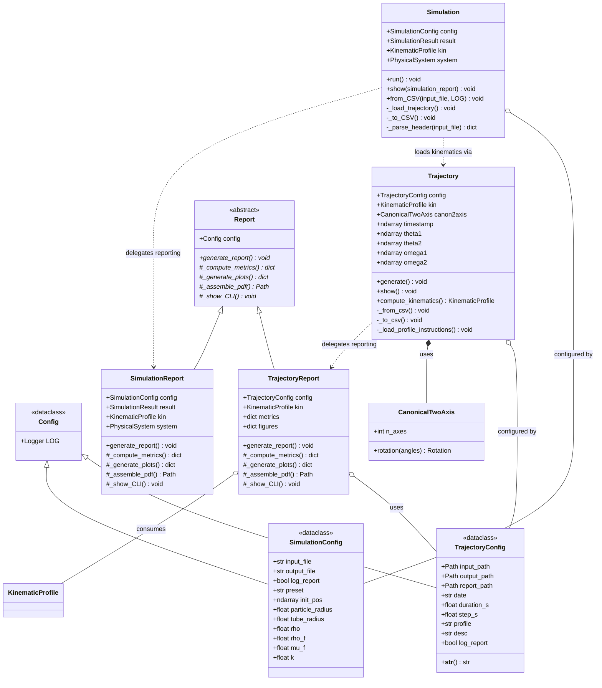

# PRISMA Architecture Specification

This document defines the software architecture, data contracts, and pipeline execution for simulating microscale particle motion inside a Random Positioning Machine (RPM).

---

## 1. Structural Overview

The package enforces a strict one-way dependency model organized around 3 modules:

```text
src/config.py (TrajectoryConfig, SimulationConfig, physical presets)
    ▲
    │
src/core/ (reference frames, canonical 2-axis kinematics, immutable data containers)
    ▲
    │
src/trajectory/ (Trajectory orchestrator, analytic/stochastic profile generators)
    ▲
    │
src/solver/ (RK4 integration, Stokes creeping regime, boundary enforcement)
    ▲
    │
src/stats/ (metrics extraction, matplotlib rendering, multi-page PDF assembling)
    ▲
    │
src/cli.py (lightweight argparse parser, CLI-to-Config adapter, command dispatch)
```

- `config` acts as the transversal configuration layer across the repository. It standardizes input arguments, handles default presets, and provides clean terminal formatting without importing computational modules.
- `core` hosts reference frame conventions ($\mathcal{R}_0, \mathcal{R}_1, \mathcal{R}_2$), SO(3) angular mappings, and passive data structures (`KinematicProfile`, `SimulationResult`, `Particle`, `Fluid`, `PhysicalSystem`).
- `trajectory` manages synthetic profile generation, persistent CSV headers, kinematic tensor derivations, and orchestrates report compilation.
- `solver` couples a `PhysicalSystem` with a `KinematicProfile` to numerically integrate the trajectory and generate output data containers.
- `stats` consumes computed profiles or solver outputs to produce tabular terminal diagnostics and vector PDF reports via Matplotlib.
- `cli` maps command-line arguments to `Config` dataclasses and triggers orchestrator lifecycles.

---

## 2. Directory tree

Below is the physical layout of the `src/` directory. Each subpackage adheres to single-responsibility principles, hosting distinct domains of the simulation pipeline:

```text
prisma
├── CHANGELOG.md             # Detailed version and modification history
├── README.md                # User guide, quickstart, and CLI manuals
├── pyproject.toml           # Package definitions and console script entrypoints
├── requirements.txt         # Pinned third-party dependencies
├── data/
│   ├── results/             # Simulation trajectory outputs and side-car PDF reports
│   └── trajectories/        # Biaxial RPM angle profiles (.csv) and summary reports (.pdf)
├── dev/                     # Prototyping and scientific validation notebooks
├── docs/
│   ├── ARCHITECTURE.md      # Structural architecture and technical specifications
│   └── MATHEMATICS.md       # Derivation of non-inertial equations of motion
├── src/
│   ├── __init__.py
│   ├── cli.py               # Top-level argparse entrypoint (prisma trajectory / simulation)
│   ├── config.py            # Unified configurations (TrajectoryConfig, SimulationConfig)
│   ├── utils.py             # CSV header parsers, path converters, and metadata extractors
│   ├── core/
│   │   ├── __init__.py
│   │   ├── conventions.py   # Frames R0, R1, R2 and laboratory gravity vectors
│   │   ├── kinematics.py    # Canonical 2-axis gimbal rotation engine
│   │   ├── models.py        # Passive dataclass containers (KinematicProfile, SimulationResult, Particle, Fluid, PhysicalSystem)
│   │   └── physics.py       # Physical properties and regime constants
│   ├── simulation/
│   │   ├── __init__.py
│   │   ├── simulation.py    # Simulation orchestrator (run, show, CSV I/O)
│   │   └── solver.py        # Numerical integration engine (RK4Overdamped)
│   ├── stats/
│   │   ├── __init__.py
│   │   ├── metrics.py       # Statistical and kinematic reduction functions
│   │   ├── plotting.py      # Standardized plotting routines and Mollweide projections
│   │   ├── report.py        # Abstract base class Report
│   │   ├── trajectory_report.py # 3-page Trajectory report generator
│   │   └── simulation_report.py # 3-page Simulation dynamics report generator
│   └── trajectory/
│       ├── __init__.py
│       ├── Trajectory.py    # Trajectory orchestrator (lifecycle, CSV I/O, kinematics)
│       └── generators.py    # Preset kinematic profile algorithms
└── tests/                   # Pytest automated testing suite
```

An extensive test harness mirrored under `tests/` ensures bidirectional validation between kinematics and physics, enforcing contract consistency across all modules.

---

## 3. Data Contracts

Inter-module communication relies on lightweight, immutable data containers (Python dataclasses). This approach standardizes memory layouts, prevents unintended side effects during time-stepping loops, and simplifies unit-testing by clearly delineating expected inputs from computed results.

### 3.1 Unified Configuration (`src/config.py`)

Execution parameters are wrapped inside dedicated dataclasses inheriting from `Config`:

- `TrajectoryConfig`:
  - `input_path`: Optional path to an existing CSV file for inspection (`show`).
  - `output_path`: Destination path for generated CSV trajectories (`generate`).
  - `report_path`: Destination path for the 3-page PDF summary report.
  - `date`: Execution timestamp injected into file metadata.
  - `duration_s`: Total duration of the synthetic profile (in seconds).
  - `step_s`: Discretization time step $\Delta t$ (in seconds).
  - `profile`: Kinematic preset identifier (`random_walk`, `desynchronized_sine`, `constant_speed_ratio`, `static_1g`, `clinostat_1d`, `centrifuge_sweep`).
  - `desc`: Custom metadata annotation saved into the CSV header.
  - `log_report`: Boolean flag enabling automatic side-car PDF compilation.

- `SimulationConfig`:
  - `input_file`: Source CSV motor trajectory.
  - `output_file`: Destination CSV file for particle trajectory output.
  - `log_report`: Boolean flag enabling side-car PDF compilation.
  - `preset`: Predefined physical parameter set (`statolith`, `glycerol_bead`).
  - Overrides: `init_pos`, `particle_radius`, `tube_radius`, `rho`, `rho_f`, `mu_f`, `k`.
  
Each configuration is used to instantiate a `Trajectory` or `Simulation` object. The `Config` object is built by `src/cli.py` while parsing arguments.

### 3.2 Containers (`src/core/models.py`)

To manage data between the objects during the pipeline execution, we use Python `dataclasses`. `KinematicProfile` stores `Trajectory` physics properties and `SimulationResult` describe the particle motion after solving the `Trajectory` problem.

- `KinematicProfile`:
  - `timestamp`: Array of time values $t \in \mathbb{R}^N$ ($N,$).
  - `theta1`, `theta2`: Inner and outer gimbal angular positions ($N,$ in radians).
  - `omega1`, `omega2`: Gimbal rotation rates ($N,$ in rad/s).
  - `Omega`: Total angular velocity vector $\vec{\Omega}_{\mathcal{R}_2}$ in the sample frame ($(3, N)$, in rad/s).
  - `Omega_dot`: Angular acceleration vector $\dot{\vec{\Omega}}_{\mathcal{R}_2}$ ($(3, N)$, in rad/s²).
  - `g`: Apparent gravity vector $\vec{g}_{\mathcal{R}_2}(t)$ ($(N, 3)$, in m/s²).

Produced upon completion of the numerical integration, this container packages the full dynamical history of the particle along with dimensionless validation metrics, providing a single payload for downstream analysis and 3D visualization.

- `SimulationResult`:
  - `timestamp`: Discretized time vector ($N,$).
  - `positions`: Particle Cartesian coordinates $\vec{r}(t)$ in frame $\mathcal{R}_2$ ($(N, 3)$, in meters).
  - `velocities`: Instantaneous particle velocity $\vec{v}(t)$ ($(N, 3)$, in m/s).
  - `reynolds`: Instantaneous particle Reynolds number $Re_p(t)$ ($N,$).

---

## 4. Pipeline Execution Workflows

Here is described the detailled execution workflow. Firt we present the `Trajectory` life-cycle and then the `Simulation` one.

### 4.1 Trajectory Generation & Show (`Trajectory`)

`Trajectory` orchestrates the complete lifecycle of motor profiles:

```text
CLI: prisma trajectory generate / show
               │
               ▼
       TrajectoryConfig
               │
               ▼
          Trajectory
     ┌─────────┴─────────┐
     │                   │
     ▼ (generate)        ▼ (show)
generators.py         _from_csv() (parses metadata & angles)
     │                   │
     ▼                   │
  _to_csv()              │
     │                   │
     └─────────┬─────────┘
               │
               ▼
     compute_kinematics() ──► KinematicProfile
               │
               ▼ (if log_report or show)
       TrajectoryReport
         ├── _compute_metrics() (residual gravity, isotropy, power)
         ├── _generate_plots() (unit sphere, Mollweide, gimbal dynamics)
         ├── _assemble_pdf()
         └── _show_CLI()
```

### 4.2 Dynnamic Simulation Workflow (`Simulation`)

```text
CLI: prisma simulation launch / show
               │
               ▼
       SimulationConfig (or Simulation.from_csv)
               │
               ▼
          Simulation
     ┌─────────┴─────────┐
     │                   │
     ▼ (launch)          ▼ (show)
_load_trajectory()    from_csv() (parses header & SimulationResult)
     │                   │
     ▼                   │
_build_physical_system() │
     │                   │
     ▼                   │
RK4Overdamped.solve()    │
     │                   │
     ▼                   │
  _to_CSV()              │
     │                   │
     └─────────┬─────────┘
               │
               ▼ (if log_report or show)
       SimulationReport
         ├── _compute_metrics() (Re_p, drift, tortuosity, FFT, confinement)
         ├── _generate_plots() (3D confinement, dynamics, phase/FFT)
         ├── _assemble_pdf()
         └── _show_CLI()``text
```

---

## 5. Class diagram

The following class diagram illustrates the object-oriented structure of the framework, highlighting the relationship between the kinematics backend, the physical system configuration, and the polymorphic solver hierarchy:


